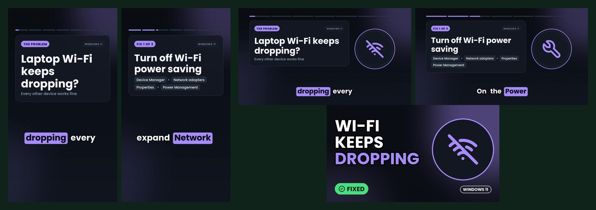
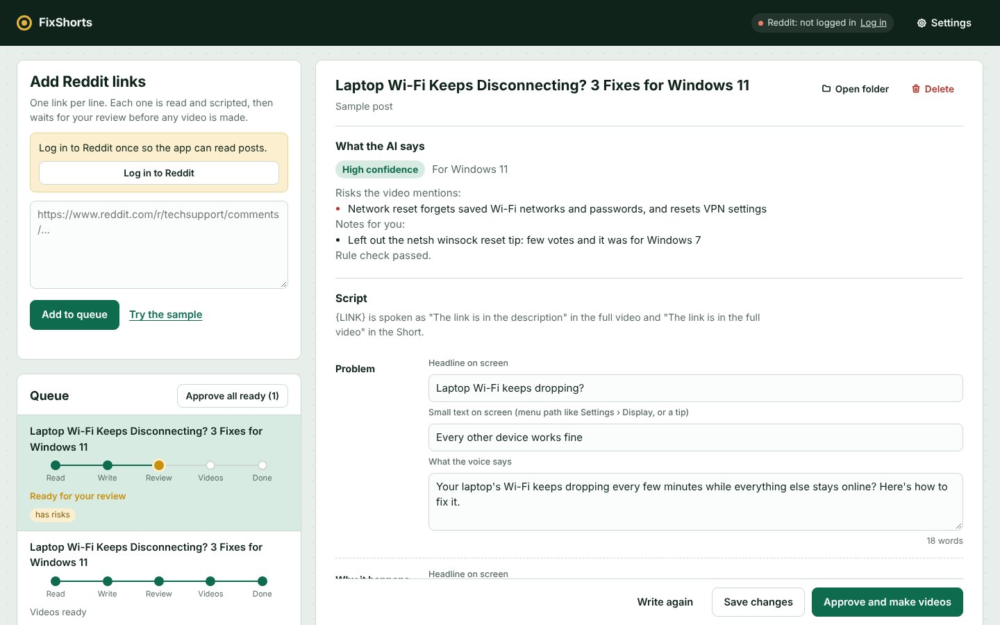

# FixShorts

Paste Reddit links about PC, phone and tech problems. FixShorts reads each post, has DeepSeek write a direct problem-and-solution script, waits for your review, then makes two videos (a vertical Short and a horizontal full video), a thumbnail, and ready-to-paste upload details. It runs on your Windows PC; only the AI script and the Edge voice go online.

## Set up (once)

1. Install **Python 3.12** from [python.org](https://www.python.org/downloads/windows/). During the install, tick **Add python.exe to PATH**.
2. Download this project (Code → Download ZIP, or `git clone https://github.com/israk404/fixshorts`) and unzip it somewhere like `C:\fixshorts`.
3. Double-click **setup.bat**. It installs the Python packages and, if needed, FFmpeg through winget. Takes a few minutes.
4. Double-click **start.bat**. The app opens in your browser at http://127.0.0.1:8765. Keep the black window open while you use it.
5. In **Settings**:
   - Paste your DeepSeek API key (from [platform.deepseek.com](https://platform.deepseek.com)) and press Save key.
   - Press **Log in to Reddit**. A browser window opens; log in with a spare Reddit account. The window closes by itself when you're done, and the app remembers the login in its own browser profile (it never touches your normal browser).

## Daily use

1. **Paste links**, one per line, and press **Add to queue**. Each link is read and scripted in turn. Nothing is made into a video yet.
2. **Review** each job marked gold ("Ready for your review"). You see:
   - what the AI says: its confidence, risks the video mentions, notes for you, and a rule check
   - the script, segment by segment: on-screen headline, small on-screen text, and what the voice says
   - links for the description, each marked Official site or Check this site, and whether it opens
   - thumbnail words and icon, titles, description, tags, hashtags and pinned comment

   Edit anything, then press **Save changes**. **Write again** asks the AI for a new script.
3. Press **Approve and make videos**, or **Approve all ready** for the whole batch. Videos are made one job at a time.
4. When a job shows **Videos ready**, open it to play both videos, copy each upload field, or open the folder.

**Uploading:** upload the full video first (`video.mp4` with `thumbnail.jpg`), then the Short (`short.mp4`). In YouTube Studio, set the Short's **Related video** to the full video. Links in Shorts descriptions aren't clickable, so the Short tells viewers the links are in the full video.

Each job's files are in `output\<date>_<topic>\`:

| File | What it is |
|---|---|
| `video.mp4` | Full video, 1920×1080 |
| `short.mp4` | Short, 1080×1920 |
| `thumbnail.jpg` | Thumbnail for the full video (1280×720) |
| `cover.jpg` | First frame of the Short, if you want a cover |
| `upload.txt` | Titles, descriptions, tags and pinned comment for both videos |
| `script.json` | The script as you approved it |

## Cost

Scripts use `deepseek-flash` with low thinking, about a quarter of a US cent per link off-peak. The top bar shows your DeepSeek balance. DeepSeek doubles its prices on weekdays from 07:00 to 10:00 and 12:00 to 16:00 Bangladesh time; the top bar warns you during those hours. You can switch to `deepseek-v4-pro` in Settings for better scripts at about 4 times the cost.

## Voices

The default is Microsoft Edge's free voices (Andrew, Brian, Ava, Emma and more; pick one and press **Play sample** in Settings). They need internet. They come through the unofficial `edge-tts` library, so Microsoft could change or limit them at any time.

As a backup, install the offline Kokoro voice once: open a terminal in the folder and run `.venv\Scripts\python.exe setup_models.py` (downloads about 350 MB). After that, if Edge ever fails, the app switches to the offline voice by itself, and you can also choose it in Settings.

## Settings

Most settings are in the app. Advanced defaults live in `config.toml`; what you change in the app is saved to `settings.json` and wins over `config.toml`.

| What | Where |
|---|---|
| DeepSeek key, model, thinking level | Settings → DeepSeek |
| Voice and speed | Settings → Voice |
| Thumbnail style (bold, problem/fixed, clean), video colors, channel name | Settings → Look |
| Reddit login, browser (Edge or Chrome) | Settings → Reddit |
| Script length | Settings → Script length |
| Channel voice and accuracy rules for the AI | `prompts\style_guide.md` |
| Script structure | `prompts\script_prompt.md` |
| Other AI providers (Gemini, OpenAI, Groq) | `config.toml`, `[ai]` section |

## Troubleshooting

- **"Reddit wants you to log in"**: Settings → Log in to Reddit. Jobs that failed only because of the login start again automatically.
- **"Couldn't open Edge or Chrome"**: close any window the app opened earlier, or pick the other browser in Settings.
- **"Edge voice didn't answer"**: check your internet. If the offline voice is installed, the app uses it instead.
- **"FFmpeg isn't installed"**: run `winget install Gyan.FFmpeg` in a terminal, then restart the app.
- **The page doesn't open**: another program may be using port 8765. Change `port` under `[app]` in `config.toml`.

## How it works

`app.py` serves the app and runs two background workers (`fixshorts/jobs.py`):

- **Prep worker:** `extract.py` reads the Reddit page in the app's own browser, `writer.py` writes the script with DeepSeek, `schema.py` checks it (no Reddit mentions, no AI-sounding phrases, length, structure), and `links.py` rates and tests each link.
- **Video worker:** after you approve, `tts_edge.py` records the voice with exact word timings, `cards.py` and `render.py` draw and encode both videos with FFmpeg (Intel Quick Sync when available), `thumbs.py` makes the thumbnail, and `kit.py` writes the upload details.

Fonts and icons: Poppins (SIL Open Font License) and Tabler Icons (MIT), in `assets/fonts`. Offline voice: Kokoro-82M (Apache 2.0).
